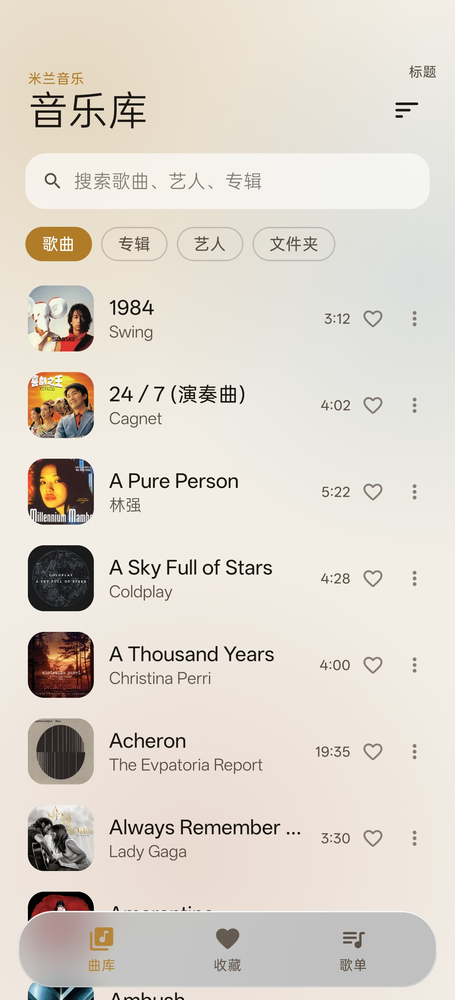

# 米兰音乐 · Milan Music

Android 本地音乐播放器。直接读取设备上的音频文件，**不联网、无广告、无账号、不采集任何数据**。

Jetpack Compose + Media3 全量重写，暖白底色配淡金描边的水墨玻璃质感。

**[下载最新版本](https://github.com/iloat20/milan-music/releases/latest)** · 签名的 APK 发布在 Releases，不随 git 仓库分发。



## 功能

| 模块 | 说明 |
|---|---|
| 曲库 | 「米兰」「喜欢」两个页签共用一个列表；按标题、艺人、专辑、添加时间、时长五种方式排序 |
| 搜索 | 跨歌名、艺人、专辑的即时过滤；两个页签共用同一份查询，切页签不清空 |
| 收藏 | 单曲喜欢，落在「喜欢」页签；播放页与列表行的心形状态同步 |
| 播放页 | 全屏覆盖层，下滑手势或返回键关闭；左右滑动封面切歌，进度拖拽、上一首 / 下一首、播放暂停 |
| 封面与倒影 | 封面下方按同一张位图逐行镜像生成倒影，模糊半径随距离阶梯递增；无内嵌封面的曲目降级为纯色场，不留上一首的图 |
| 后台播放 | Media3 `MediaSessionService`，通知栏 / 锁屏 / 蓝牙控制，封面同步 |
| 桌面小组件 | 2×2 卡片，显示封面与曲名，可直接播放暂停；封面圆角在 Android 8–11 上同样生效 |
| 主题图标 | Android 13+ 自适应图标的 monochrome 层 |

## 权限

只申请本地播放必需的权限。成品 APK 的实测清单（`aapt2 dump permissions`）：

```
READ_MEDIA_AUDIO
READ_EXTERNAL_STORAGE            (maxSdkVersion=32)
POST_NOTIFICATIONS
FOREGROUND_SERVICE
FOREGROUND_SERVICE_MEDIA_PLAYBACK
WAKE_LOCK
```

Media3 会传递引入 `INTERNET` 与 `ACCESS_NETWORK_STATE`，清单里用 `tools:node="remove"` 显式移除，
所以包里没有任何网络权限——这一行同样是护栏：谁删掉它，权限就会漏进成品。

## 技术栈

| 层 | 选型 |
|---|---|
| UI | Jetpack Compose（BOM 2026.09.00）、Material 3 |
| 播放 | Media3 1.11.1（ExoPlayer + MediaSession，音频卸载**关闭**；优先 Android 17 进程内软解，gapless 由 PCM 路径按 encoder delay/padding 裁剪） |
| 模糊 / 玻璃 | Haze 2.0.1（只用 `haze-glass`；`haze-blur` 已移除，本项目不需要额外的模糊层） |
| 持久化 | DataStore Preferences + kotlinx.serialization |
| 音乐库 | MediaStore 查询 + 磁盘缓存 |
| 构建 | AGP 9.4.1、Kotlin 2.4.21、Gradle 9.8.2、JDK 17 |
| 平台 | minSdk 26 / targetSdk 37 / compileSdk 37 |

主代码 40 个 Kotlin 文件、约 8.2k 行；`src/test` 10 个文件、87 个用例。

## 构建

前置：JDK 17、Android SDK（platform 37）、`ANDROID_HOME` 或 `local.properties` 中的 `sdk.dir`。

```bash
git clone git@github.com:iloat20/milan-music.git
cd milan-music

# 指向本机 SDK（不要提交这个文件）
echo "sdk.dir=$HOME/Android/Sdk" > local.properties

./gradlew :app:assembleDebug
```

产物：`app/build/outputs/apk/debug/app-debug.apk`（包名 `com.milan.music.debug`）。

### Release 签名

release 构建读取 `~/.android/milanmusic-release.keystore`，口令来自 `local.properties`（已被 `.gitignore` 排除）：

```properties
KEYSTORE_STORE_PASSWORD=...
KEYSTORE_KEY_PASSWORD=...
```

缺失时 debug 构建不受影响，只有 release 签名会报 keystore 错误。

```bash
./gradlew :app:assembleRelease :app:bundleRelease
```

## 项目结构

```
app/src/main/java/com/milan/music/
├── MainActivity.kt          单 Activity 宿主，权限与 onStop 生命周期
├── MilanMusicApp.kt         Application，装配 AppContainer
├── di/AppContainer.kt       手工依赖注入
├── data/
│   ├── media/               MediaStore 扫描、封面读取与缓存、位图预算
│   ├── model/               Track、SortMode 等数据模型
│   ├── prefs/               DataStore 设置（排序方式）
│   └── userdata/            收藏的本地存储
├── play/                    PlayerController（MediaController 客户端）
│                            PlaybackService、ArtworkBitmapLoader、解码器选择
├── ui/
│   ├── library/             曲库首页、歌曲/喜欢列表、LibraryViewModel
│   ├── player/              播放页、PlayerViewModel、PlayerArtwork
│   │                        封面轮播、取色、倒影几何
│   ├── components/          封面、列表行、迷你播放器、自绘图标
│   ├── glass/               Haze 玻璃材质封装
│   ├── util/                交互修饰符与格式化
│   └── theme/               配色、字体、动效、主题
└── widget/                  桌面小组件
```

播放页是**覆盖层**而非导航目的地：`HomeScreen` 始终保留在 Compose 树中，下滑关闭时能直接露出下层页面（Navigation-Compose 的 pop 过渡做不到这一点）。

播放页不持有依赖容器：`PlayerScreen(PlayerViewModel, PlayerController, ArtworkRepository, onBack)`。控制器与仓库只喂给封面轮播——轮播要等播放会话确认换曲才肯翻页，把这部分状态抄进 ViewModel 会让同一份事实在两处各自演化。

## 已知问题

- **播放服务随进程存活**：启动即播意味着队列几乎总是非空，而 `MediaController` 是 bound client——服务不会随 UI 退出而销毁。这是「打开应用就开始放」的代价，不是遗漏；细节见 `PlayerController.onUiStopped` 的 KDoc。
- **界面文案写在 Compose 里**，未走 `strings.xml`：暂无多语言计划。
- **只有 JVM 单测，没有 `androidTest`**：`src/test` 覆盖封面几何、取色、缓存预算、倒影阶梯、图标墨色与封面归属共 87 例。布局与手势仍需真机冒烟——第 55 批（叠层照实报高，把信息区全部挤出屏幕）和第 57 批（倒影内容错位，看起来像封面出现了两次）都属于只有 UI 测试才抓得住的那一类。

## 审查与迭代记录

`review/` 保留了完整的工程审查与逐批执行记录，包括每一项改动的原因、验证方式与未验证清单：

| 文件 | 内容 |
|---|---|
| `2026-10-23-release-1.0.61.md` | 1.0.61 发布说明：播放页改由 `PlayerViewModel` 承载、封面像素按曲目作废；并入 1.0.54~1.0.59 的倒影带子重做 |
| `2026-10-23-code-review.md` | 全量代码审查：P0 四项、P1 七项，含依赖方向现状与目标架构、逐条「不建议做」的理由 |
| `2026-10-23-b59-no-flash.md` | 带子与翻页同帧：切歌不再闪一下；附「缓存切片装不下一张位图，该缓存从未生效」的取证 |
| `2026-10-23-b58-band-rides-cover.md` | 倒影叠层跟随封面横移：叠层与轮播读同一个位移，钉在屏幕上就会和封面脱开 |
| `2026-10-23-b57-exact-mirror.md` | 「封面出现两次」的根因：`Image(contentScale, alignment)` 的定位依赖「缩放后高度 == 框高」，倒影节点高度不等，于是整体滑动 |
| `2026-10-22-liquid-glass-measured-gap.md` | 玻璃折射的可见度与背景高频的关系：均匀背景上物理上就看不见 |
| `2026-10-22-glass-body.md` | 奶白体改成乘性薄幕：压 tint 无效，主项在 `whitePoint` 与 `contrast` |
| `2026-10-21-liquid-glass-t2.md` | 玻璃边缘三路归零（specular / ambient / edge shadow）的实测对比 |
| `2026-10-20-release-1.0.53.md` | 1.0.53 发布说明：修复暂停时点下一首/上一首不自动播放（`resumeIfPaused`，仅换曲分支调用）；米兰 tab 太极点击旋转 180°（累积角度，420 ms） |
| `2026-10-20-release-1.0.52.md` | 1.0.52 发布说明：曲库改名米兰、tab 图标换成应用太极（去描边 + 黑白两半）、喜欢 tab 改收藏红；切 tab 清空查询；封面 in-flight 取消、HARDWARE 位图、MediaStore 异常与深色启动白屏四项稳定性修复 |
| `2026-10-18-app-review.md` | 首次全量审查（P0–P3 共 60+ 项） |
| `2026-10-19-batch-a-fixes.md` ~ `batch-e-lint-zero.md` | 五批修复与 lint 清零的执行记录 |
| `2026-10-19-batch-f-tech-refresh.md` | 音频卸载启用、小组件圆角跨版本修复，及其实测待验证清单 |
| `2026-10-19-batch-g-梯队二.md` | 预测式返回落地；音效链与共享元素过渡的待决策项 |
| `2026-10-19-batch-h-genai-prompt-评估.md` | ML Kit GenAI Prompt API 可行性评估：三条否决项与"仅作查询解析器"的备选形态 |
| `2026-10-19-memory-power-audit.md` | 内存与功耗专项审查（M1–M8 / P1–P8），含 Haze 2.0.1 API 反编译与平台 trim 档位核对 |
| `2026-10-19-batch-i-memory-power.md` | 批次 I 执行记录：位图缓存回收出口、进度轮询订阅门控、内嵌封面两趟解码、release 日志剥离 |
| `2026-10-19-batch-j-memory-power-ii.md` | 批次 II 执行记录：MediaStore 扫描水位线、小组件封面缓存与广播门控、位图真实记账；附 offload 与 float 输出关系的源码取证 |
| `2026-10-19-m2-haze-performance-mode.md` | M2：`LocalHazePerformanceMode = Performance`；更正审计里模糊采样层的三处数字（1.57→0.63 MB 而非 7 MB），并说明 P2 为何是产品决策 |
| `2026-10-19-inprocess-codec-eval.md` | Android 17 进程内音频解码器评估：技术成立，含 API 36/37 逐行 diff；"offload 命中时链路上没有解码器"的推论已被真机推翻（见该文档 §八勘误） |
| `2026-10-19-inprocess-codec-introduce.md` | 引入 D1 解码器偏好：三层排序（硬件 → inproc → 其余软件）而非草案的无条件前移；埋点发现 `onOffloadedPlayback` 在 media3 1.11.1 是死方法 |
| `2026-10-19-android17-transport-loudness-eval.md` | 传输与响度评估：LHDC v5 在应用层无观测面（API 37 无常量、codecType 已废弃）；CTA-2075 的 `LoudnessCodecController` 实为 API 35 引入且只对带响度元数据的码流生效；xHE-AAC/IAMF 的版本归属与 extractor 缺口核对 |
| `2026-10-19-usb-dac-bitperfect-eval.md` | USB DAC 直通评估：`MIXER_BEHAVIOR_BIT_PERFECT` 可用但仅限 USB + `USAGE_MEDIA`，与当前 float 输出冲突；libusb 直通被官方文档列为问题来源；DSD 需自写 extractor |
| `2026-10-19-lossy-restoration-eval.md` | 有损修复评估：谐波重建是合成非恢复、立体声细节在信息论上不可逆；实时 DSP 必须关 offload（拿确定的功耗换主观听感），建议只做频谱截止检测 |
| `2026-10-19-oboe-latency-eval.md` | Oboe / AAudio 评估：API 27 门槛与 OpenSL 回退属实，但实时线程里不能解码；44.1k 源与低延迟路径互斥；本地播放没有输入端，结论是不做 |
| `2026-10-19-offload-keep-or-disable.md` | offload 收益与门槛全解：省解码功耗、绕 mixer、sink 休眠；`isGaplessSupportRequired(true)` 在 API 29–32 上使命中率恒为 0（media3 字节码取证）。原结论"保留 offload"，已由该文档 §九 决策反转（关闭） |
| `2026-10-19-preload-and-offload-eval.md` | 预加载与卸载核实：offload 送的是压缩帧不是 PCM（`audio/raw` 被显式排除）；`PreloadMediaSource` 场景错配，首播延迟大头在本项目的 `bufferForPlaybackMs=250` |
| `2026-10-19-scan-metadata-io-eval.md` | 扫描与封面核实：MediaStore 本就有 `samplerate`/`bits_per_sample` 两列（无需 jaudiotagger，且项目无 Room/Room 表）；RGB_565 的收益是命中率翻倍而非峰值下降，因为 LRU 上限按字节写死 |
| `2026-10-19-device-verification.md` | 真机验收（OPPO Android 17）：冷启 207–228 ms / D1 选中 inproc AAC（17 ms）；P3 水位线被 MediaProvider 拒绝 `COUNT(*)` 而静默失效；offload 因设备只报 BITSTREAM(4) 而永不命中，与 gapless 无关 |
| `2026-10-19-bg-audio-and-pipeline-eval.md` | 进程内解码间接收益 + Android 17 后台音频加固核实：media3 无 AAudio/Oboe 通路（103 类中 0 处）、解码不在回调线程；后台音频两档要求本项目已满足；CDD 30 ms 属音频编码器且自 Android 13 起存在 |
| `2026-10-19-p3-generation-stamp-fix.md` | P3 修复：聚合投影换成 `MediaStore.getGeneration()`（返回 long，跨重启稳定），聚合仅留作 API 26–29 兜底；tracks 与印章同事务写入；增删双向真机验证 |
| `2026-10-19-artwork-sampling-fix.md` | 封面三条建议核实：API 29+ 的 `loadThumbnail` 已跨进程直接产出目标尺寸；DiskLruCache 让位于 provider 内建的缩略图磁盘缓存；弱引用不采纳。补掉 API 26–28 的 `getBitmap()` 全尺寸解码缺口 |
| `2026-10-19-decode-buffer-pool.md` | 解码缓冲池化核实：codec 缓冲由 `MediaCodec` 管、预读缓冲已有 `DefaultAllocator` 池，真正可动的只有 `trimOnReset`；`getNativeHeapAllocatedSize` 漏 mmap/ashmem，口径应为 `MemoryInfo.nativePss` |
| `2026-10-19-library-scan-io-eval.md` | 扫描 IO 核实：1 读 + 1 写已是理论下限（MediaProvider 已在系统侧解完标签，无需 jaudiotagger）；查出 `stamp()` 重复调用与「扫描期间新增歌曲被永久跳过」的时序缺陷 |
| `2026-10-19-lifecycle-release-and-trim-eval.md` | 释放链路核实：`player.release()` → `MediaCodecAudioRenderer.onDisabled()` 同时覆盖 codec 与 AudioTrack，应用层直接 release 会踩已释放句柄；`onTrimMemory` 缺 `RUNNING_MODERATE` 档，且分支必须按常量值降序 |
| `2026-10-19-fgs-and-scheduling-eval.md` | 前台服务与调度核实：`mediaPlayback` 类型 + 权限齐备，Doze 不受影响，暂停后 10 分钟自动退出前台（`MediaNotificationManager` 字节码）；扫描挪 WorkManager 会让「加歌即见」退化为手动刷新 |
| `2026-10-19-background-sample-rate-eval.md` | 后台降采样核实：`DefaultAudioSink.Builder` 无采样率 setter，`SonicAudioProcessor` 只有 speed/pitch；48k→44.1k 只少搬 8.1% 样本却要多付一次 SRC，理论上限 0.5–0.8% 且方向为负 |
| `2026-10-19-hardware-decoder-priority-eval.md` | 硬件解码优先核实：`InProcessCodecSelector` 已保证硬件层整体在头；「硬解省 35%」属视频或 audio offload；AOSP 音频解码组件全为 C2Soft，`hardwareAccelerated` 分区在事实上可能为空 |
| `2026-10-20-release-1.0.51.md` | 1.0.51 发布说明：毛玻璃删描边、模糊源上提到容器、奶白体换成乘性薄幕，并入动效批次 K |
| `2026-10-20-release-1.0.50.md` | 1.0.50 发布说明：队列元数据按需解析、4 MB 缓冲字节上限、封面预算收缩与播放页进度重组下沉 |
| `2026-10-20-motion-animations.md` | 动效批次：统一节奏、迷你播放器/列表/播放页动画，及共享元素与进度 ticker 的取舍 |
| `2026-10-19-release-1.0.49.md` | 1.0.49 发布说明：3 条阻断 + 3 条高优先修复，release 收敛为 arm64-v8a 单 ABI |
| `2026-10-19-release-1.0.48.md` | 1.0.48 发布说明：索引水位线、解码器偏好、封面与缓冲内存专项九项合并发布，含 dex 探针与「压缩后体积连续五版相同」的取证 |
| `2026-10-19-release-1.0.46.md` | 1.0.46 发布说明：offload / 小组件圆角 / 预测式返回三项合并发布 |
| `2026-10-19-release-1.0.47.md` | 1.0.47 发布说明：内存与功耗专项十项合并发布（缓存回收出口、轮询门控、扫描水位线、Haze 降采样），含 dex/mapping 取证 |
| `2026-10-19-release-1.0.45.md` | 1.0.45 发布说明：搜索框空态文案移除与图标调整 |
| `2026-10-19-code-review-1.0.44.md` | 1.0.44 合并前代码审查 |
| `2026-10-19-release-1.0.44.md` | 1.0.44 发布说明与产品取舍 |

## 说明

仓库未附 License，保留所有权利。视频/音频文件不随仓库分发。
